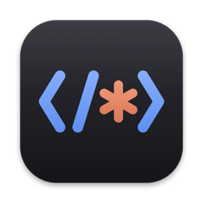
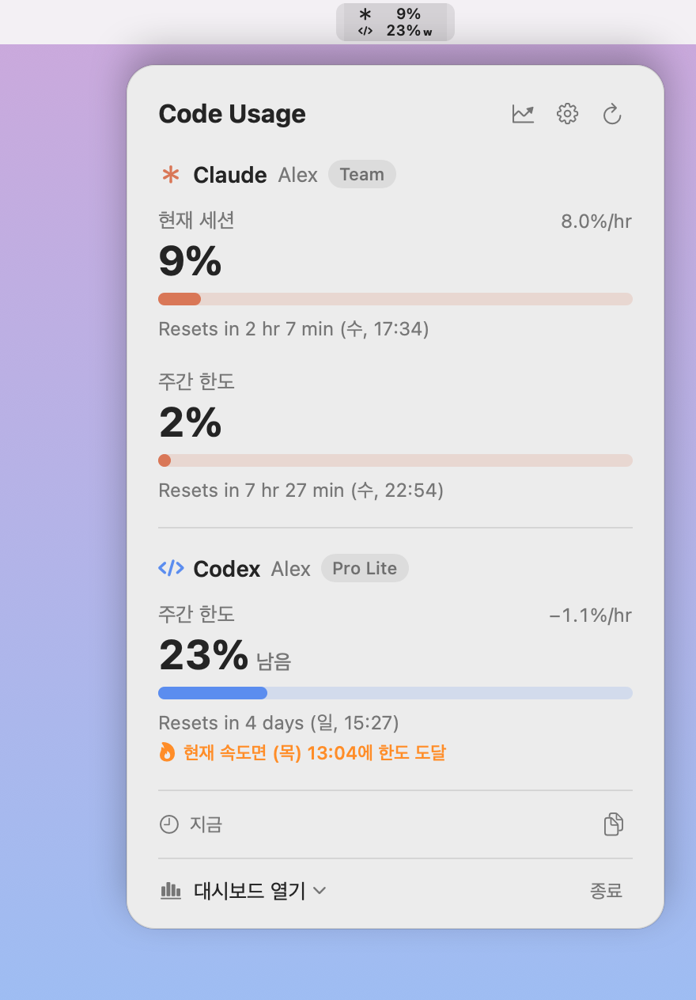

<p align="center">
  
</p>

<h1 align="center">Code Usage</h1>

<p align="center">
  <b>Claude</b>와 <b>Codex</b>의 플랜 사용량을 한 번에 보여 주는 작은 macOS 메뉴 막대 앱입니다.
</p>

<p align="center">
  <a href="README.md">English</a> · <b>한국어</b>
</p>

<p align="center">
  <picture>
    <source media="(prefers-color-scheme: dark)" srcset="docs/images/hero-dark.png">
    
  </picture>
</p>

> 스크린샷은 앱에 내장된 샘플 데이터로 만든 것입니다.

## 기능

- **좁은 메뉴 막대 항목** — Claude와 Codex 값을 위아래 두 줄로 표시합니다(폭 약 40pt).
  현재 세션이 진행 중이면 세션 값을, 아니면 주간 한도 값을 보여 주며 주간 한도 값에는 작은 `w`가 붙습니다.
- **팝오버** — 공급자별 현재 세션, 주간 한도, 모델별 주간 한도, 리셋까지 남은 시간, 소모 속도(%/hr),
  현재 속도면 리셋 전에 한도에 도달할 때의 경고.
- **사용량 / 남은 양** — 공급자별로 퍼센트를 사용량으로 볼지 남은 양으로 볼지 고를 수 있습니다.
  기본값은 각 서비스 화면과 같게 Claude는 사용량, Codex는 남은 양입니다.
- **기록** — 최근 8일 사용량을 `~/Library/Application Support/CodeUsage/history.json`에 저장하고 차트로 보여 줍니다.
- **별도 로그인 없음** — 이 Mac의 Claude Code, Codex CLI가 이미 가진 로그인 정보를 재사용합니다.
- AppKit + SwiftUI, 외부 의존성 없음, macOS 14 이상.

## 데이터를 가져오는 방법

| 공급자 | 자격 증명 | 사용량 API |
|---|---|---|
| Claude | 키체인 항목 `Claude Code-credentials` (`/usr/bin/security`로 읽음), 없으면 `~/.claude/.credentials.json` | `GET https://api.anthropic.com/api/oauth/usage` |
| Codex | `$CODEX_HOME/auth.json` (기본 `~/.codex/auth.json`, ChatGPT 로그인) | `GET https://chatgpt.com/backend-api/wham/usage` |

토큰은 로그·화면·파일 어디에도 출력하지 않으며, 아래 자동 갱신 때 CLI 저장소에 다시 기록하는 경우만 예외입니다.
기본 새로고침 주기는 2분이고 설정에서 바꿀 수 있습니다(최소 30초). 잠자기에서 깨어나면 바로 새로고침합니다.

## 요구 사항

- macOS 14 이상, Xcode 명령줄 도구(Swift 6 툴체인)
- [Claude Code](https://docs.anthropic.com/en/docs/claude-code) 또는 [Codex](https://github.com/openai/codex)(ChatGPT 로그인)에 로그인되어 있어야 합니다

## 빌드 · 설치 · 실행

```sh
scripts/build.sh                 # build/CodeUsage.app 생성 (release, ad-hoc 서명)
scripts/build.sh --install       # ~/Applications/CodeUsage.app 에 설치 (실행 중이면 종료 후 교체)
scripts/build.sh --install --run # 설치 후 실행
scripts/build.sh --run           # 설치 없이 build/CodeUsage.app 실행
```

로그인 시 자동 실행은 설정 창의 **로그인 시 실행**에서 켭니다(`~/Applications`에 설치한 앱에서 사용하세요).

## 토큰 자동 갱신 주의

설정의 **토큰 자동 갱신**(기본 켜짐)은 액세스 토큰이 만료됐을 때 리프레시 토큰으로 새 토큰을 받아
**CLI의 저장소에 다시 기록**합니다(Claude Code 키체인 항목 / `~/.codex/auth.json`). 리프레시 토큰은 회전될 수 있어서,
CLI가 같은 시점에 직접 갱신하면 어느 한쪽이 무효가 된 토큰을 가질 수 있습니다. 이때는 터미널에서 `claude` 또는
`codex`를 한 번 실행하면 복구됩니다. CLI 저장소를 건드리고 싶지 않다면 이 옵션을 끄세요. 끄면 토큰이 만료됐을 때
CLI를 한 번 실행하라는 안내만 표시합니다.

## 디버그 플래그

```sh
B=build/CodeUsage.app/Contents/MacOS/CodeUsage

$B --dump                        # 두 공급자를 한 번씩 조회해 스냅샷을 JSON으로 출력
CODEUSAGE_DEBUG=1 $B --dump      # 원본 사용량 응답도 stderr로 출력 (헤더·토큰은 출력하지 않음)
$B --render-preview /tmp/cu      # 내장 샘플 데이터로 팝오버/메뉴 막대를 2x PNG로 렌더링 (네트워크 없음)
```

## 에셋 다시 만들기

```sh
swift scripts/make-icon.swift    # 앱 아이콘 → Resources/AppIcon.icns (없으면 build.sh가 자동 생성)

build/CodeUsage.app/Contents/MacOS/CodeUsage --render-preview /tmp/cu-shots \
    -claudeShowsRemaining NO -codexShowsRemaining YES
swift scripts/make-readme-shots.swift /tmp/cu-shots docs/images   # README 스크린샷
```

## 안내

Anthropic, OpenAI와 관계없는 비공식 개인 프로젝트입니다. 공개 문서가 없는 API를 사용하므로 언제든 바뀌거나
동작하지 않을 수 있습니다.

## 라이선스

MIT — [LICENSE](LICENSE) 참고.
