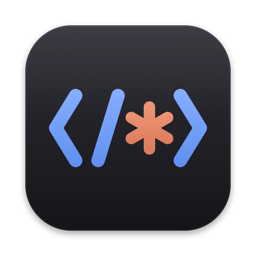
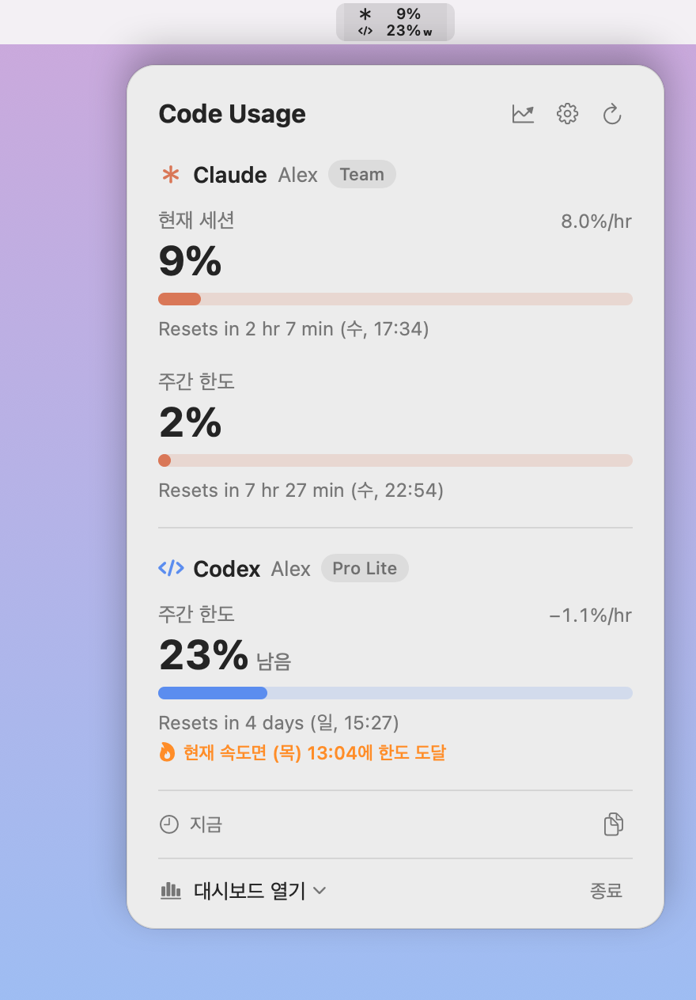

<p align="center">
  
</p>

<h1 align="center">Code Usage</h1>

<p align="center">
  A tiny macOS menu bar app that shows your <b>Claude</b> and <b>Codex</b> plan usage side by side.
</p>

<p align="center">
  <b>English</b> · <a href="README.ko.md">한국어</a>
</p>

<p align="center">
  <picture>
    <source media="(prefers-color-scheme: dark)" srcset="docs/images/hero-dark.png">
    
  </picture>
</p>

> Screenshots use built-in sample data. The app's UI is in Korean.

## Features

- **Compact menu bar item** — two stacked rows, one for Claude and one for Codex, about 40 pt wide.
  Each row shows the current session while one is running, otherwise the weekly limit (marked with a small `w`).
- **Popover** — per provider: current session, weekly limit and per-model weekly limits, time until reset,
  burn rate (%/hr), and a warning when the current pace would hit the limit before the reset.
- **Used or remaining** — choose per provider whether percentages show usage or what is left.
  Defaults match each service's own UI: Claude shows used, Codex shows remaining.
- **History** — the last 8 days are kept in `~/Library/Application Support/CodeUsage/history.json` and shown as charts.
- **No extra login** — reuses the logins the Claude Code and Codex CLIs already have on your Mac.
- Native AppKit + SwiftUI, no third-party dependencies, macOS 14+.

## How it works

| Provider | Credentials | Usage endpoint |
|---|---|---|
| Claude | Keychain item `Claude Code-credentials` (read via `/usr/bin/security`), falling back to `~/.claude/.credentials.json` | `GET https://api.anthropic.com/api/oauth/usage` |
| Codex | `$CODEX_HOME/auth.json` (default `~/.codex/auth.json`, ChatGPT login) | `GET https://chatgpt.com/backend-api/wham/usage` |

Tokens are never logged, displayed or written anywhere except back to the CLI's own store (see below).
Usage refreshes every 2 minutes by default (configurable, minimum 30 s) and right after the Mac wakes.
Each provider is scheduled on its own. If an endpoint answers **HTTP 429**, that provider is left alone for
the server's `Retry-After` (or 5 → 10 → 20 → 30 min without one, never sooner than the refresh interval) —
including when you open the popover or press refresh — while the other provider keeps its normal schedule.

## Requirements

- macOS 14 or later, Xcode command line tools (Swift 6 toolchain)
- Signed in to [Claude Code](https://docs.anthropic.com/en/docs/claude-code) and/or [Codex](https://github.com/openai/codex) (ChatGPT login)

## Build and install

```sh
scripts/build.sh                 # build build/CodeUsage.app (release, ad-hoc signed)
scripts/build.sh --install       # install to ~/Applications/CodeUsage.app (quits a running copy first)
scripts/build.sh --install --run # install and launch
scripts/build.sh --run           # launch build/CodeUsage.app without installing
```

Turn on **Launch at login** in Settings (use the copy installed in `~/Applications`).

## Token auto-refresh

**Auto-refresh tokens** (on by default) renews an expired access token with the refresh token and
**writes the new tokens back to the CLI's store** (the Claude Code keychain item / `~/.codex/auth.json`),
so the CLI keeps working. Refresh tokens can rotate, so if the CLI refreshes at the same moment one side may
end up with an invalidated token; running `claude` or `codex` once fixes it. Turn the option off if you do not
want the app to touch the CLI stores — it will then only ask you to run the CLI when a token expires.

## Debug flags

```sh
B=build/CodeUsage.app/Contents/MacOS/CodeUsage

$B --dump                        # fetch both providers once and print the snapshots as JSON
CODEUSAGE_DEBUG=1 $B --dump      # also print the raw usage responses to stderr (never headers or tokens)
$B --render-preview /tmp/cu      # render the popover and menu bar item to 2x PNGs from sample data (no network)
```

## Regenerating assets

```sh
swift scripts/make-icon.swift    # app icon → Resources/AppIcon.icns (build.sh runs it if missing)

build/CodeUsage.app/Contents/MacOS/CodeUsage --render-preview /tmp/cu-shots \
    -claudeShowsRemaining NO -codexShowsRemaining YES
swift scripts/make-readme-shots.swift /tmp/cu-shots docs/images   # README screenshots
```

## Disclaimer

This is an unofficial personal project, not affiliated with Anthropic or OpenAI. It relies on undocumented
endpoints that may change or stop working at any time.

## License

MIT — see [LICENSE](LICENSE).
